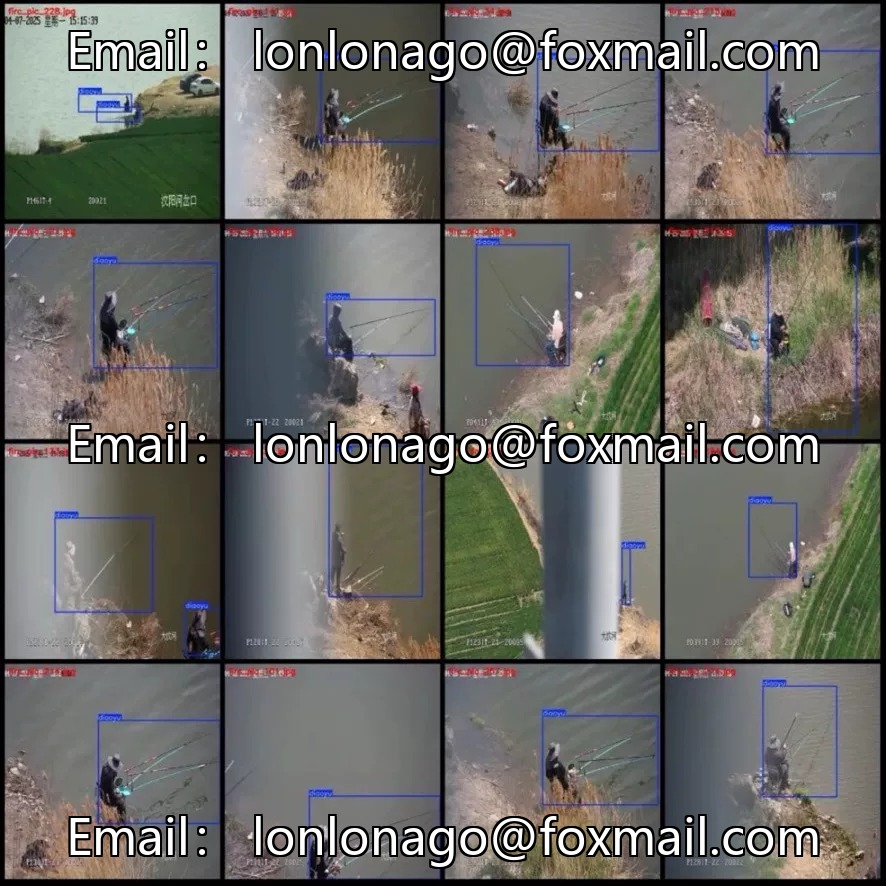
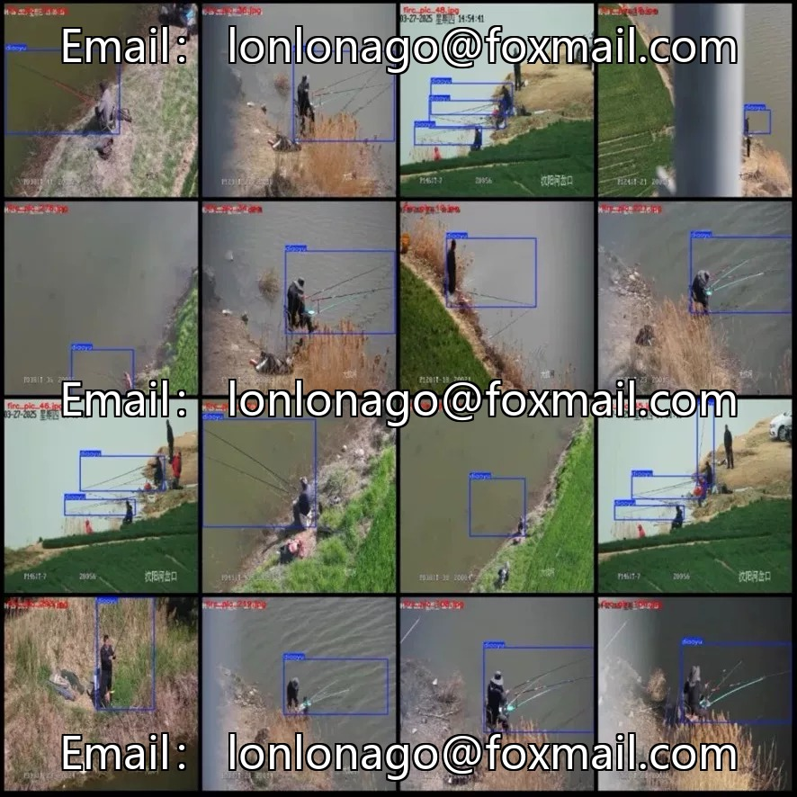
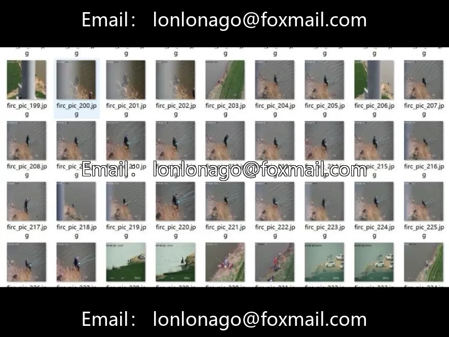

# Monitoring perspective fishing personnel fishing detection dataset, 322 images with a resolution of 640×640

## Body

Monitoring perspective fishing detection dataset, 322 images of 640×640 resolution, single-category "fishing" (diaoyu), with 400 labeled boxes, some scenes include multiple people fishing. The scene is fixed monitoring perspective, including shores, bridges, etc., the target size is medium to small, and there are diverse actions, which need to be judged based on context such as fishing rods.

Suitable for water safety management, illegal fishing monitoring, reservoir/lake intelligent inspection and other scenarios, focusing on "Is there anyone fishing", directly corresponding to law enforcement needs. The data volume is moderate, it is recommended to combine with data augmentation or transfer learning. It is necessary to partition the training/validation/test set, which is suitable for rapid prototype validation.

Virtual materials, once sold, are non-refundable.
Interested friends, click "I want" to proceed.

## Images

## Payment

Here is a pay link on Stripe ( https://buy.stripe.com/3cs8yP7sY87d0vu9AB ). Please contact me lonlonago@foxmail.com after funding $89, and I will send you a complete data files , thank you!

